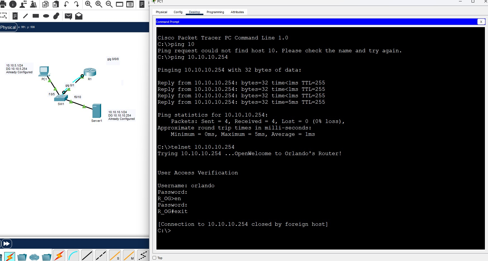

# Cisco Inter-VLAN Routing and Remote Access Lab

## Project Overview

This project demonstrates a Cisco Packet Tracer network configured to provide connectivity between different IP networks and allow remote access to a Cisco router.

The lab contains a PC, Cisco switch, Cisco router, and server. Connectivity and remote access were tested from PC1 using the command prompt.

---

## Network Topology

The network shown in the lab includes:

- **PC1:** `10.10.5.1/24`
- **PC1 Default Gateway:** `10.10.5.254`
- **Server1:** `10.10.10.1/24`
- **Server1 Default Gateway:** `10.10.10.254`
- **Cisco Switch:** SW1
- **Cisco Router:** R1

The PC and server are connected to SW1, which connects to R1.

---

## Connectivity Testing

After configuring the network, I tested connectivity from PC1 to the `10.10.10.254` router interface using:

```text
ping 10.10.10.254
```

The ping test was successful:

```text
Packets: Sent = 4, Received = 4, Lost = 0 (0% loss)
```

This shows that PC1 was able to successfully reach `10.10.10.254`.

---

## Remote Access Testing

I also tested remote router access from PC1 using Telnet:

```text
telnet 10.10.10.254
```

The connection successfully reached the router and displayed the router login prompt.

After authentication, I was able to enter privileged EXEC mode and then exit the remote session.

This demonstrated successful remote CLI connectivity to the router.

---

## Project Screenshot



The screenshot shows the completed Cisco Packet Tracer topology along with the successful connectivity and remote-access testing.

The ping to `10.10.10.254` returned **4 successful replies with 0% packet loss**. The screenshot also shows a successful Telnet connection to the router, user authentication, access to privileged EXEC mode, and a clean exit from the remote session.

---

## Security Considerations

Telnet was used in this lab to demonstrate remote-access configuration and connectivity in a simulated environment.

In a production network, **SSH should be preferred over Telnet** for remote device administration because SSH provides encrypted communication. Telnet does not provide the same protection for transmitted credentials and management traffic.

This lab was performed in Cisco Packet Tracer for educational and portfolio purposes. Any credentials used in the lab are test credentials and should not be reused on real systems.

---

## What I Learned

Through this project, I gained hands-on experience with:

- Configuring and testing a Cisco network in Packet Tracer
- Working with multiple IPv4 networks
- Understanding the role of default gateways
- Testing network connectivity using `ping`
- Establishing remote router access using Telnet
- Navigating the Cisco IOS command-line interface
- Entering privileged EXEC mode on a Cisco router
- Troubleshooting basic connectivity issues
- Understanding why SSH is preferred over Telnet for secure remote administration
- Verifying that a network configuration is working instead of relying only on configuration commands

This lab helped strengthen my understanding of Cisco networking, remote device management, network testing, and basic network security concepts.

---

## Skills Demonstrated

- Cisco Packet Tracer
- Cisco IOS
- IPv4 Addressing
- Network Connectivity Testing
- Ping
- Telnet
- Remote Router Administration
- Default Gateway Configuration
- Network Troubleshooting
- Basic Network Security
