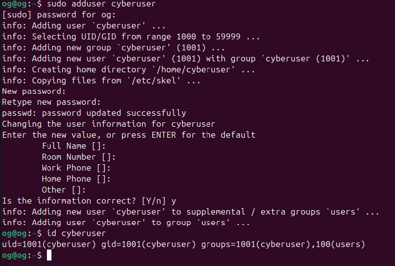
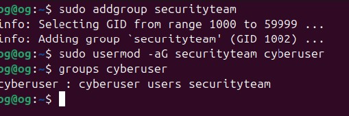
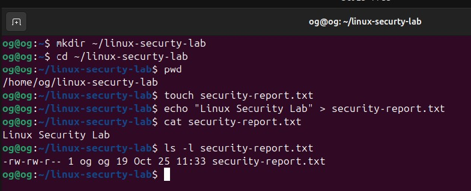
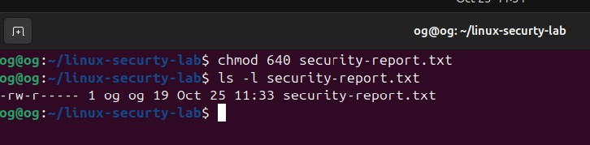
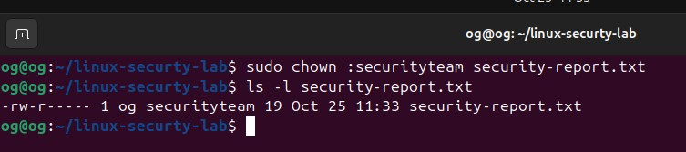
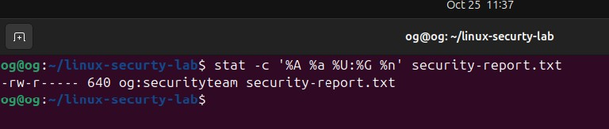
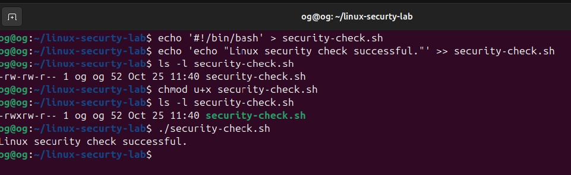

# Linux User and File Permission Security Lab

## Project Overview

In this lab, I practiced Linux user and group administration, file ownership, file permissions, and basic access control. The goal was to gain hands-on experience with how Linux administrators control access to files and system resources.

## Objective

The objective of this project was to create and manage a Linux user and security group, configure file permissions and ownership, and verify that the security settings were applied correctly.

## Environment

- Linux / Ubuntu
- Bash
- Linux Command Line Interface (CLI)

## Skills Demonstrated

- Linux administration
- User account management
- Group management
- File and directory permissions
- File ownership
- Access control
- Bash commands
- Linux troubleshooting

---

## 1. User Account Creation and Verification

I created a practice Linux user named `cyberuser` and verified the account using the `id` command.

```bash
sudo adduser cyberuser
id cyberuser
```

### Evidence



---

## 2. Security Group Configuration

I created a group named `securityteam`, added `cyberuser` to the group, and verified the user's group membership.

```bash
sudo addgroup securityteam
sudo usermod -aG securityteam cyberuser
groups cyberuser
```

### Evidence



---

## 3. File Creation and Original Permissions

I created a lab directory and a test file named `security-report.txt`. I then examined the file's original permissions using `ls -l`.

```bash
mkdir ~/linux-security-lab
cd ~/linux-security-lab
touch security-report.txt
echo "Linux Security Lab" > security-report.txt
ls -l security-report.txt
```

### Evidence



---

## 4. File Permission Configuration

I used `chmod` to change the permissions of `security-report.txt` to `640`.

```bash
chmod 640 security-report.txt
ls -l security-report.txt
```

The `640` permission setting provides:

- Owner: Read and Write
- Group: Read
- Others: No permissions

### Evidence



---

## 5. File Group Ownership

I changed the group ownership of `security-report.txt` to `securityteam` and verified the change.

```bash
sudo chown :securityteam security-report.txt
ls -l security-report.txt
```

This associates the file with the `securityteam` group while maintaining the configured access permissions.

### Evidence



---

## 6. Permission and Ownership Verification

I used the `stat` command to verify the final permissions, numeric permission value, owner, group, and filename.

```bash
stat -c '%A %a %U:%G %n' security-report.txt
```

The final configuration demonstrated:

```text
Permissions: 640
Group: securityteam
File: security-report.txt
```

### Evidence



---

## 7. Executable Bash Script

I created a basic Bash script and modified its permissions to allow the owner to execute it.

```bash
echo '#!/bin/bash' > security-check.sh
echo 'echo "Linux security check successful."' >> security-check.sh
chmod u+x security-check.sh
ls -l security-check.sh
./security-check.sh
```

The script executed successfully after the execute permission was applied.

### Evidence



---

## Cybersecurity Relevance

Linux user accounts, groups, ownership, and file permissions are important components of system access control. This lab demonstrated how permissions can be configured to limit access to resources based on users and groups.

The project also provided hands-on experience with the principle of limiting access by configuring specific permissions instead of allowing unrestricted access.

## Commands Practiced

```bash
whoami
id
groups
adduser
addgroup
usermod
mkdir
touch
echo
cat
ls -l
chmod
chown
stat
```

## Results

I successfully:

- Created and verified a Linux user account
- Created a security group
- Added a user to the security group
- Created files and directories
- Examined Linux file permissions
- Modified file permissions with `chmod`
- Modified group ownership with `chown`
- Verified permissions and ownership
- Created-on experience using Linux command-line tools to configure and verify access controls.

These skills provide a foundation for Linux system administration and cybersecurity.
